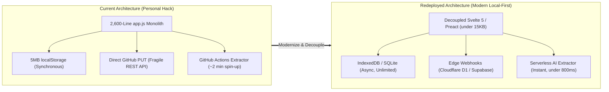
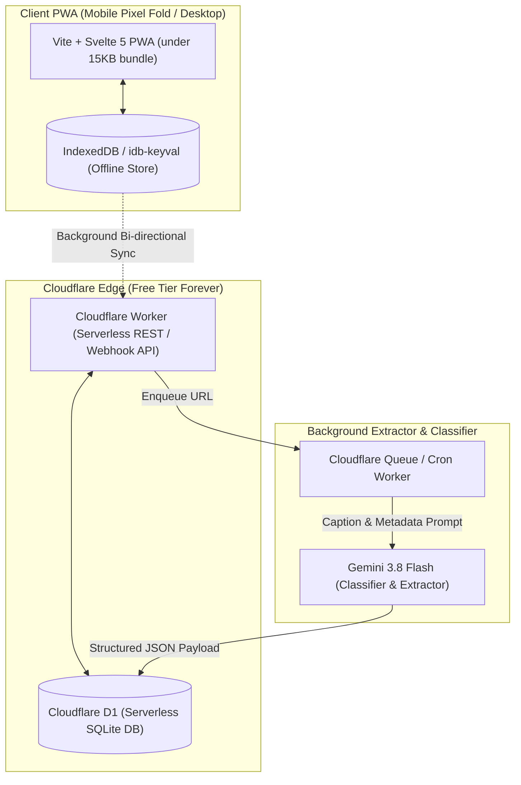
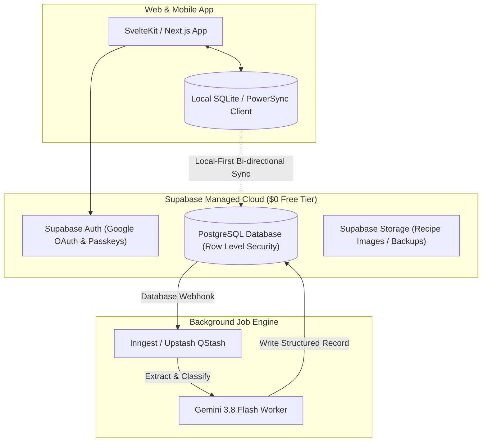

# Active Desks 2.0 — Fresh Redeployment Architecture Blueprint

> [!NOTE]
> This blueprint outlines the production-grade architectural redesign for deploying **Active Desks** cleanly for new users, eliminating monolithic debt while preserving zero-friction capture, anti-guilt daily rhythms, and near-zero operating costs.

---

## 1. Executive Summary & Architectural Goals

The current implementation of Active Desks proves the core product thesis: **zero-friction intake, anti-guilt daily anchors, and CQRS projections solve productivity burnout**. However, the single monolithic codebase (`app.js` at 2,600+ lines, synchronous `localStorage`, and direct Git API commits) needs modern decoupling before handing it to other users.



---

## 2. Scenario A: The "Zero-Cost Personal Template" (Recommended)

* **Target Audience**: Developers, technical friends, and open-source self-hosters who want complete data privacy and **$0.00/month operating cost**.
* **Key Idea**: Local-First PWA + Cloudflare Workers & Serverless SQLite (D1).



### Scenario A Stack Details:
1. **Frontend**:
   - **Vite + Svelte 5**: Compiles to tiny, raw JavaScript without virtual DOM overhead.
   - **PWA Service Worker**: Full offline support with background sync API.
   - **IndexedDB**: Asynchronous persistence with no 5MB limit.
2. **Backend & Database**:
   - **Cloudflare Worker**: Runs in V8 isolates at edge data centers globally.
   - **Cloudflare D1 (SQLite)**: Free tier includes **100,000 queries per day** and **5GB storage for $0.00/month**.
3. **AI Pipeline**:
   - Webhook instantly triggers Gemini 3.8 Flash; updates D1 and broadcasts changes back to the PWA via Server-Sent Events (SSE) or polling.

---

## 3. Scenario B: The "Turnkey Multi-User SaaS" (Zero Setup for Users)

* **Target Audience**: Non-technical friends or family who want a seamless login (Google Auth or Passkeys) with zero technical configuration.
* **Key Idea**: SvelteKit / Next.js with Supabase (PostgreSQL + Auth + Row Level Security).



---

## 4. Technical Tradeoff Comparison

| Dimension | Current Implementation | Scenario A (Cloudflare + Svelte) | Scenario B (Supabase SaaS) |
|---|---|---|---|
| **Monthly Cost** | **$0.00** | **$0.00** (Free Cloudflare Tier) | **$0.00** up to 50k users (Supabase Free Tier) |
| **User Setup** | Requires GitHub PAT & Gemini Key | 1-Click Fork / Deploy to Cloudflare | Standard Google / Passkey login |
| **Storage Limit** | 5MB (`localStorage`) | **5GB** (Cloudflare D1) | **500MB** free, scalable (Postgres) |
| **Sync Speed** | ~2–5s (Git commit + push) | **< 200ms** (SQLite Edge API) | **< 100ms** (Realtime / PowerSync) |
| **Code Structure** | 1 Monolith (`app.js` ~2,600 lines) | Modular components (50–150 lines) | Modular components (50–150 lines) |
| **Offline Capability** | 100% Offline (PWA) | 100% Offline (Local-First IndexedDB) | 100% Offline (Local SQLite Sync) |
| **Maintenance Burden** | High (Monolith editing risk) | Very Low (Standard modern tools) | Low (Managed Postgres & Auth) |

---

## 5. Recommended Modular File Structure (Scenario A)

```
active-desks-next/
├── public/
│   ├── favicon.ico
│   ├── manifest.json
│   └── icons/
├── src/
│   ├── app.html
│   ├── main.js
│   ├── lib/
│   │   ├── core/
│   │   │   ├── db.js             # IndexedDB wrapper (idb-keyval)
│   │   │   ├── store.js          # Reactive state store
│   │   │   └── sync.js           # Cloudflare D1 background sync
│   │   ├── components/
│   │   │   ├── DailyAnchors.svelte
│   │   │   ├── QuickCaptureBar.svelte
│   │   │   ├── UniversalDrawer.svelte
│   │   │   ├── TopicFilterPills.svelte
│   │   │   └── EvolutionBanner.svelte
│   │   ├── desks/
│   │   │   ├── ReadingNook.svelte
│   │   │   ├── KitchenShelf.svelte
│   │   │   ├── GamingRig.svelte
│   │   │   ├── FiberArts.svelte
│   │   │   └── DynamicWorkbench.svelte # User-configurable desks
│   │   └── styles/
│   │       ├── tokens.css        # Color palette & glassmorphism
│   │       └── global.css
├── server/
│   ├── schema.sql                # SQLite schema for D1
│   ├── worker.js                 # Edge API endpoints
│   └── extractor.js              # Gemini 3.8 Flash crawler & classifier
├── wrangler.toml                 # Cloudflare configuration
├── package.json
└── vite.config.js
```

---

## 6. Recommended Migration Path

If you ever decide to build this clean version:

1. **Step 1: Export Current Master Stream**:
   - Use the backup button or download `captures.json` to keep your existing recipes, books, and thoughts intact.
2. **Step 2: Initialize Scenario A Skeleton**:
   - Initialize a minimal Vite + Svelte 5 PWA in a new folder.
   - Seed `db.js` with your exported `captures.json`.
3. **Step 3: Deploy Cloudflare Worker + D1**:
   - Run `npx wrangler d1 create active-desks-db` to spin up your free serverless SQLite database.
4. **Step 4: Wire Webhooks & PWA Install**:
   - Test offline capture on your Pixel Fold and verify 0ms local persistence.
